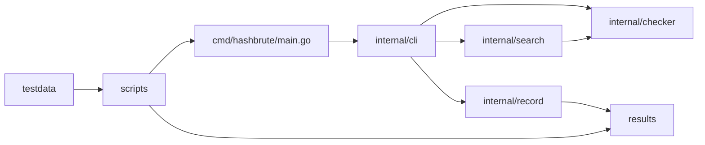

# Файловая структура проекта

Этот документ объясняет, где находится код, входные данные, сценарии запуска и результаты экспериментов проекта `hashbrute`.

## Структура верхнего уровня

```text
.
├── cmd/
│   └── hashbrute/
│       └── main.go
├── internal/
│   ├── checker/
│   │   ├── checker.go
│   │   ├── digest.go
│   │   ├── bcrypt.go
│   │   └── argon2id.go
│   ├── cli/
│   │   └── run.go
│   ├── record/
│   │   └── csv.go
│   └── search/
│       ├── config.go
│       ├── cursor.go
│       └── engine.go
├── scripts/
│   ├── run-go.sh
│   └── run-hashcat.sh
├── testdata/
│   ├── hashes.tsv
│   └── experiments.example.tsv
├── results/
│   ├── .gitkeep
│   ├── go-report.csv
│   └── experiments-report.tsv
├── docs/
│   ├── FILE_STRUCTURE.md
│   └── superpowers/
│       ├── plans/
│       └── specs/
├── .superpowers/
│   └── sdd/
├── README.md
├── AGENTS.md
├── go.mod
└── go.sum
```

## Исходный код

### `cmd/hashbrute/`

Точка входа исполняемого файла.

- `main.go` создаёт контекст, который отменяется по `Ctrl+C`, передаёт аргументы командной строки и стандартные потоки в `cli.Run`, затем завершает процесс с полученным кодом возврата.
- В этом каталоге не хранится бизнес-логика: он только связывает операционную систему с внутренними пакетами.

Сборка команды:

```bash
go build -o hashbrute ./cmd/hashbrute
```

### `internal/cli/`

Слой командной строки и основная точка сборки компонентов приложения.

- `run.go` описывает флаги CLI, проверяет их значения и создаёт нужный `checker.Checker`.
- Здесь выбирается число workers: для обычных алгоритмов автоматически используется число CPU, а для Argon2id по умолчанию — один worker из-за потребления памяти.
- Этот слой создаёт конфигурацию поиска, применяет тайм-аут, выводит прогресс и итоговый результат.
- Если передан `-output`, здесь формируется запись для CSV.
- Здесь же статусы поиска преобразуются в коды завершения процесса: `found`/`exhausted` → `0`, `timeout` → `1`, `cancelled` → `130`, ошибка → `2`.

Изменять этот пакет нужно при добавлении или изменении CLI-флагов, формата консольного вывода, правил запуска и кодов возврата.

### `internal/checker/`

Проверка кандидата на соответствие целевому хэшу.

- `checker.go` содержит общий интерфейс `Checker` и фабрику `New`. Интерфейс скрывает различия между алгоритмами от поискового движка.
- `digest.go` разбирает hex-строки и проверяет кандидаты для MD5 и SHA-1.
- `bcrypt.go` валидирует bcrypt-хэш, извлекает cost и сравнивает кандидаты через `golang.org/x/crypto/bcrypt`.
- `argon2id.go` разбирает PHC-строку Argon2id, хранит параметры `m`, `t`, `p`, соль и целевой ключ, затем вычисляет ключ для каждого кандидата.

Новый алгоритм добавляется здесь: нужна реализация `Checker` и новая ветка в `checker.New`. Если алгоритму нужны новые внешние зависимости, они также отражаются в `go.mod` и `go.sum`.

### `internal/search/`

Независимый от конкретного алгоритма движок полного перебора.

- `config.go` содержит профили алфавитов (`digits`, `lower`, `alnum`, `printable`), границы длины, число workers и расчёт полного пространства поиска.
- `cursor.go` разбивает пространство на задания по длине и первому символу. `Cursor` последовательно генерирует кандидаты внутри одного задания, переиспользуя буфер.
- `engine.go` распределяет задания между workers, вызывает `Checker.Match`, считает попытки, формирует снимки прогресса и возвращает один из статусов `found`, `exhausted`, `timeout` или `cancelled`.

Изменения в порядке генерации кандидатов, распараллеливании, расчёте прогресса или статусах поиска относятся к этому пакету.

### `internal/record/`

Запись результатов запуска.

- `csv.go` описывает структуру одной записи, заголовок CSV и добавление строк в файл.
- Родительский каталог создаётся автоматически.
- При первом запуске записывается заголовок; последующие запуски добавляют строки в тот же файл.

Изменять этот пакет нужно при изменении состава или формата колонок отчёта.

Пакеты находятся под `internal/`, поэтому Go запрещает импортировать их из других модулей. Это подчёркивает, что они являются внутренней реализацией команды `hashbrute`, а не публичной библиотекой.

## Сценарии экспериментов

### `scripts/run-go.sh`

Автоматизирует серию запусков реализации на Go.

Сценарий:

1. собирает временный бинарник `hashbrute`;
2. читает каталог хэшей и манифест экспериментов;
3. находит хэш по паре `algorithm + label`;
4. запускает каждый эксперимент с одним и несколькими workers;
5. добавляет результаты в CSV.

Основные переменные окружения:

- `HASHES_FILE` — путь к каталогу хэшей;
- `EXPERIMENTS_FILE` — путь к манифесту экспериментов;
- `OUTPUT` — итоговый CSV;
- `MULTI_WORKERS` — число workers для многопоточного запуска;
- `ARGON2_WORKERS` — разрешает многопоточный запуск Argon2id; без неё Argon2id выполняется с одним worker.

### `scripts/run-hashcat.sh`

Запускает тот же набор экспериментов через Hashcat, чтобы сравнить реализацию на Go с внешним инструментом.

Сценарий выбирает режим Hashcat по алгоритму, строит mask по профилю алфавита, ограничивает время запуска, сохраняет сводный CSV и отдельные логи. Переменная `DEVICE_TYPE` выбирает `cpu` или `gpu`; остальные пути задаются через `HASHES_FILE`, `EXPERIMENTS_FILE` и `OUTPUT`.

## Входные данные

### `testdata/hashes.tsv`

Каталог исходных хэшей. Формат TSV:

```text
algorithm<TAB>label<TAB>hash
```

- `algorithm` — `md5`, `sha1`, `bcrypt` или `argon2id`;
- `label` — логическое имя сложности, используемое манифестом;
- `hash` — закодированный целевой хэш.

Связка `algorithm + label` должна быть уникальной и должна совпадать с записью в манифесте экспериментов.

### `testdata/experiments.example.tsv`

Короткий пример манифеста серийного запуска. Колонки:

```text
case_id<TAB>algorithm<TAB>label<TAB>charset<TAB>min_length<TAB>max_length<TAB>timeout
```

Файл задаёт идентификатор случая, нужный хэш, профиль алфавита, диапазон длины и лимит времени. Его можно скопировать за пределы репозитория и передать скриптам через `EXPERIMENTS_FILE`.

Каталог называется `testdata`, но автоматические тесты из него не запускаются. Это воспроизводимые входные наборы для ручных и серийных запусков.

## Результаты

### `results/`

Артефакты измерений и отчётов.

- `.gitkeep` сохраняет каталог в Git, даже когда в нём нет отчётов.
- `go-report.csv` содержит результаты запусков Go-реализации: статус, найденный пароль, число попыток, время, скорость, размер пространства поиска и параметры хэша.
- `experiments-report.tsv` содержит расширенный манифест экспериментов, по которому был сформирован отчёт.
- `run-hashcat.sh` также может создать здесь CSV Hashcat и каталог `hashcat-logs/` с полными логами отдельных запусков.

Файлы в `results/` — результаты экспериментов, а не входные данные приложения и не исходный код.

## Документация и служебные файлы

### `docs/`

- `FILE_STRUCTURE.md` — этот обзор структуры проекта.
- `superpowers/specs/` — сохранённые проектные спецификации и проектные решения.
- `superpowers/plans/` — планы реализации изменений.

### `.superpowers/`

Служебные материалы процесса разработки, созданные инструментами проектирования. Они не участвуют в сборке и выполнении `hashbrute`.

### `README.md`

Пользовательская документация: назначение программы, команды сборки и ручного запуска, флаги, статусы, коды возврата и примеры серийных экспериментов.

### `AGENTS.md`

Правила работы с репозиторием для автоматизированных помощников. В частности, проект проверяется сборкой и ручным запуском; отдельные тестовые файлы добавлять не следует.

### `go.mod` и `go.sum`

- `go.mod` задаёт имя модуля `beza`, версию Go и прямые зависимости.
- `go.sum` фиксирует контрольные суммы модулей, чтобы зависимости загружались воспроизводимо.

Эти файлы изменяются командами Go при добавлении, удалении или обновлении зависимостей.

## Поток выполнения



Обычный запуск проходит так:

1. `main.go` передаёт управление в `cli.Run`.
2. CLI разбирает параметры и создаёт checker выбранного алгоритма.
3. CLI создаёт конфигурацию и запускает поисковый движок.
4. Движок генерирует кандидаты и передаёт их checker-у.
5. CLI печатает результат и при необходимости добавляет запись в CSV.

## Где вносить изменения

| Требуемое изменение | Основное место |
|---|---|
| Новый флаг или изменение вывода команды | `internal/cli/run.go` |
| Новый алгоритм хэширования | `internal/checker/` и фабрика в `checker.go` |
| Новый встроенный алфавит | `internal/search/config.go` |
| Изменение перебора или многопоточности | `internal/search/cursor.go`, `internal/search/engine.go` |
| Новая колонка CSV | `internal/record/csv.go` и формирование `record.Record` в `internal/cli/run.go` |
| Новый эксперимент | отдельный TSV по образцу `testdata/experiments.example.tsv` |
| Новый эталонный хэш | каталог по формату `testdata/hashes.tsv` |
| Изменение пакетного запуска | `scripts/run-go.sh` или `scripts/run-hashcat.sh` |
| Пользовательская инструкция по запуску | `README.md` |
| Архитектурное описание структуры | `docs/FILE_STRUCTURE.md` |
